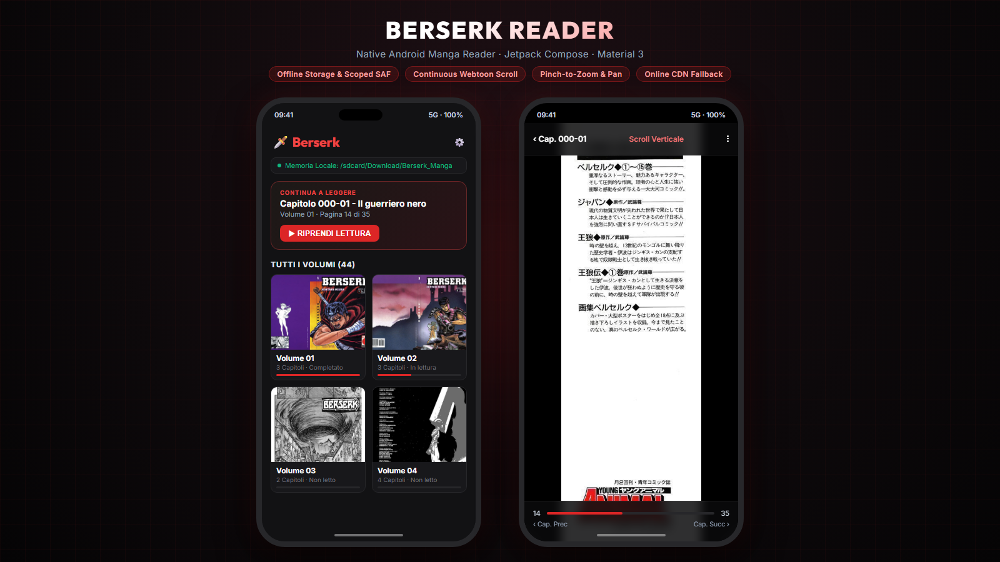

# Berserk Manga Downloader & Android Reader App

[](https://kotlinlang.org)
[](https://developer.android.com/jetpack/compose)
[](https://www.python.org)
[-red.svg)](https://developer.android.com)

A complete project designed to download all chapters of **Berserk** organized by volume from web archives, convert them to CBZ archives, and read them comfortably via a modern native Android application built with **Kotlin** and **Jetpack Compose** (Material 3).

<p align="center">
  
</p>

---

## ⚠️ Disclaimer

> [!IMPORTANT]
> This project was developed strictly for **educational, research, and personal archival purposes**.  
> **Berserk** is the intellectual property of **Kentaro Miura / Studio Gaga / Hakusensha**.  
> Please support the official release by purchasing the physical manga volumes or official digital editions from licensed publishers (e.g., Dark Horse Comics, Panini Comics).

---

## 📁 Repository Structure

```
berserk_reader/
├── Berserk_Manga/              # Downloaded manga directory (local storage)
│   ├── Volume 01/
│   │   ├── Chapter 000-01/
│   │   │   ├── 01.jpg
│   │   │   └── ...
│   └── ...
├── download_berserk.py          # Multithreaded Python scraper and downloader
├── export_to_cbz.py             # Script to convert manga volumes into .CBZ format
├── full_catalog.json           # Complete catalog indexing all 44 volumes & 404 chapters
├── generate_full_catalog.py    # Generator script for catalog indexing
├── BerserkReaderApp/            # Modern Android Reader app (Kotlin + Jetpack Compose)
│   ├── app/
│   │   ├── src/main/java/com/berserk/reader/
│   │   │   ├── MainActivity.kt
│   │   │   ├── navigation/AppNavigation.kt
│   │   │   ├── model/MangaModels.kt
│   │   │   ├── data/MangaRepository.kt & PreferencesManager.kt
│   │   │   └── ui/screens/ (HomeScreen, VolumeDetailScreen, ReaderScreen)
│   │   └── src/main/assets/berserk_catalog.json
│   └── build.gradle.kts
└── README.md
```

---

## 🚀 1. Python Manga Downloader (`download_berserk.py`)

A multithreaded scraper built with `requests`, `urllib3`, and `ThreadPoolExecutor`. It features automatic network retry, sanitized directory naming for Windows/Android Scoped Storage, and resumable execution (skips already downloaded pages).

### Usage:

- **Download all 44 volumes:**
  ```bash
  python download_berserk.py --all
  ```

- **Download a specific volume range (e.g. Volumes 1 to 5):**
  ```bash
  python download_berserk.py --volume 1-5
  ```

- **Download a single volume (e.g. Volume 10):**
  ```bash
  python download_berserk.py --volume 10
  ```

- **Specify a custom destination folder:**
  ```bash
  python download_berserk.py --all --output "D:/Manga/Berserk"
  ```

---

## 📦 2. CBZ Exporter (`export_to_cbz.py`)

Converts downloaded volumes into standard `.cbz` comic book archives compatible with external e-readers (such as Mihon, Tachiyomi, Kuro Reader, Perfect Viewer, CDisplayEx):

```bash
# Export all downloaded volumes to .cbz
python export_to_cbz.py

# Export a single volume
python export_to_cbz.py --volume 1
```

---

## 📱 3. Android Reader App (`BerserkReaderApp`)

A modern, high-performance Android reader themed with a dark-fantasy aesthetic and crimson red accents, built using:
- **Kotlin** & **Jetpack Compose**
- **Material 3 Design System**
- **Navigation Compose** with deep-link query parameter state handling
- **Coil** for asynchronous image decoding with 512 MB disk cache and memory caching
- **Gesture handling:** pinch-to-zoom, pan boundaries, and double-tap zoom to inspect artwork details.

### ✨ Key Features:

1. **Dual Reading Mode (Offline & Online):**
   - **Offline Mode:** Select your local `Berserk_Manga` folder directly inside the app (with full Android 11+ `MANAGE_EXTERNAL_STORAGE` and SAF tree URI support). Read all pages instantly without an internet connection.
   - **Online Mode:** Built-in CDN streaming fallback if local files have not yet been transferred to device storage.
2. **Home Screen Dashboard:**
   - **"Continue Reading"** card: one-click resume from the exact last-read chapter and page.
   - Volume Grid: overview of all 44 volumes with covers, chapter counts, and reading progress indicators.
3. **Volume Detail Screen:**
   - Detailed chapter listing with read checkmark indicators and instant chapter launching.
4. **Immersive Reader Screen:**
   - **Two reading modes:**
     - **Continuous Vertical Scroll:** Webtoon style with smooth fling physics.
     - **Horizontal Paged Mode:** Page-by-page swipe with natural pagination transitions.
   - **Auto-hiding System Bars & UI Overlays:** Tap screen center to toggle controls, chapter navigation, and slider.
   - **State Persistence:** Preserves scroll position across screen rotations and chapter switches without UI freeze.

---

## 🛠️ Building & Installing the App

### Option A: Install Pre-built APK
Download the compiled `BerserkReader.apk` from the [GitHub Releases](https://github.com/gio961gio/berserk-manga-reader/releases) page and install it directly on your Android phone or tablet.

### Option B: Build from Source with Android Studio
1. Open the `BerserkReaderApp` folder in **Android Studio** (Koala / Ladybug or newer).
2. Sync the project with Gradle files.
3. Click **Run > Run 'app'** or **Build > Build APK(s)**.

### Option C: Build from Command Line
```bash
cd BerserkReaderApp
./gradlew assembleDebug
```
The compiled APK will be generated at:
`BerserkReaderApp/app/build/outputs/apk/debug/app-debug.apk`

---

## ⚖️ Copyright Notice
Manga content and artwork are copyright of Kentaro Miura, Studio Gaga, and Hakusensha.
